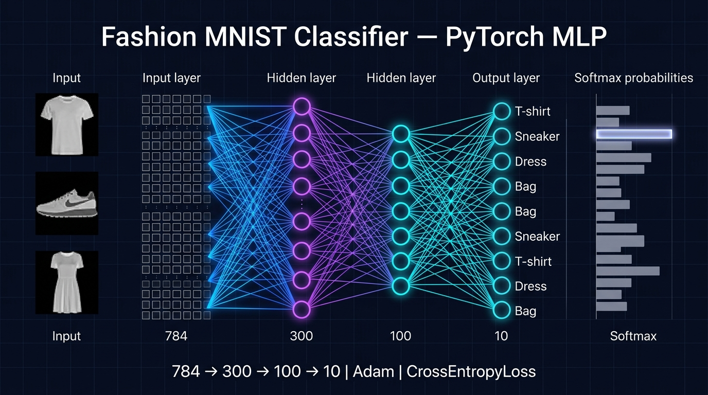

# 👕 Fashion-MNIST Classifier (PyTorch MLP)

A multi-layer perceptron built with **PyTorch** that classifies 28×28 grayscale clothing images from the **Fashion-MNIST** dataset into 10 categories (T-shirt, Trouser, Pullover, Dress, Coat, Sandal, Shirt, Sneaker, Bag, Ankle boot).



## 🧠 Model

```
Input 28×28 → Flatten (784)
            → Linear(784, 300) → ReLU
            → Linear(300, 100) → ReLU
            → Linear(100, 10)   (logits for 10 classes)
```

| Setting | Value |
|---------|-------|
| Loss | Cross-entropy |
| Optimizer | Adam (default lr) |
| Batch size | 32 |
| Epochs | 10 |
| Data split | 55,000 train / 5,000 validation / 10,000 test |
| Metric | `torchmetrics` multiclass accuracy |

## 📊 Results

Validation accuracy per epoch:

| Epoch | 1 | 2 | 3 | 4 | 5 | 6 | 7 | 8 | 9 | 10 |
|-------|---|---|---|---|---|---|---|---|---|----|
| Val acc | 85.5% | 86.6% | 87.3% | 86.9% | 87.8% | 88.0% | **89.0%** | 88.5% | 87.3% | 88.6% |

Sample predictions on validation images: **Sneaker** (98.3% confidence), **Coat** (96.3%), **Pullover** (59.1%).

## 🔬 Notebook walkthrough (`main.ipynb`)

1. Load Fashion-MNIST with `torchvision` (`ToImage` + `ToDtype(float32, scale=True)`).
2. Split the training set into train / validation and wrap in `DataLoader`s.
3. Define the `ImageClassifier` MLP.
4. Train for 10 epochs on GPU (if available), reporting validation accuracy each epoch.
5. Predict classes for new images and show softmax probabilities.

## ▶️ Run it

```bash
git clone https://github.com/Adarshmilan/NNfationMNIST.git
cd NNfationMNIST
pip install torch torchvision torchmetrics jupyter
jupyter notebook main.ipynb
```

The dataset is already included under `datasets/FashionMNIST/` (it will also download automatically if missing).
